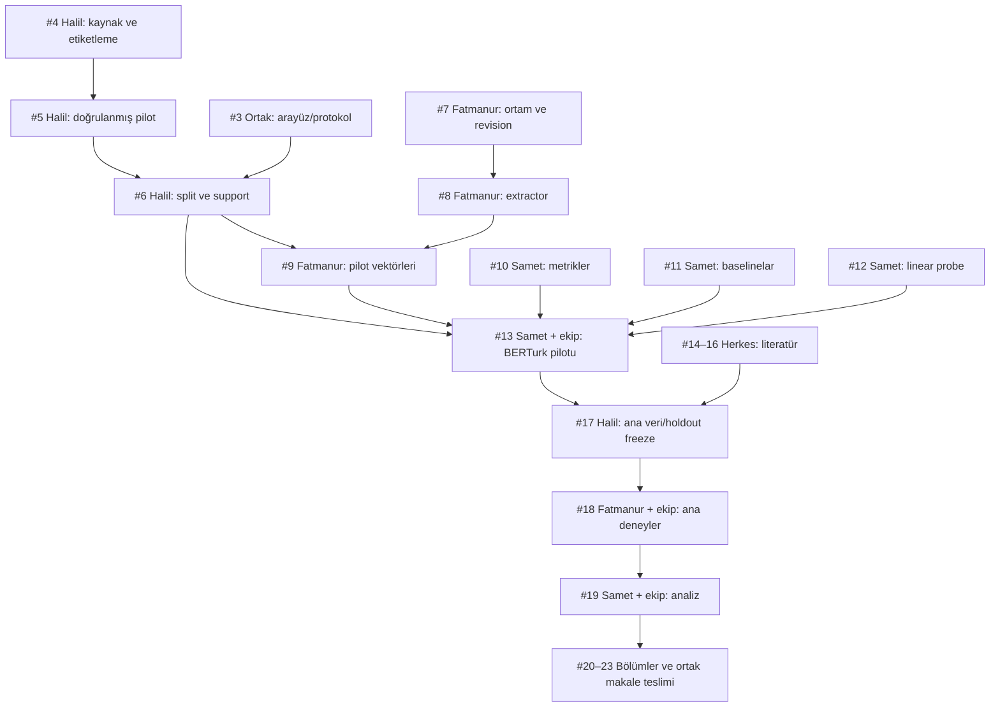

# GitHub iş dizini

Ana takip: [#1](https://github.com/mathissdupont/NLP-Project/issues/1). [Çalışma akışı](GITHUB_WORKFLOW.md), [tüm issue'lar](https://github.com/mathissdupont/NLP-Project/issues) ve [milestone'lar](https://github.com/mathissdupont/NLP-Project/milestones).

Aşağıdaki tablo ilk planın haritasıdır; güncel durum ve bağımlılıklar GitHub issue'larının native Relationships alanında tutulur. Blocker, tamamlanıp kapanması gereken ön koşuldur. İskelet yazımı, literatür veya fixture testleri gerçek veri beklemeden yapılabilir.

| Issue | İş | Sorumlu | Çapraz inceleyen | Kapanış ön koşulları |
| --- | --- | --- | --- | --- |
| [#1](https://github.com/mathissdupont/NLP-Project/issues/1) | [Takip] Türkçe morfoloji araştırması: görevler, bloklar ve teslimler | @mathissdupont | Ortak | Yok |
| [#2](https://github.com/mathissdupont/NLP-Project/issues/2) | [Workflow] Issue bağımlılıkları, PR şablonları ve CI akışını kur | @mathissdupont | Ortak | Yok |
| [#3](https://github.com/mathissdupont/NLP-Project/issues/3) | [Ortak] Pilot protokolünü ve veri–temsil–tahmin arayüzlerini kesinleştir | @mathissdupont | Ortak | Yok |
| [#4](https://github.com/mathissdupont/NLP-Project/issues/4) | [Halil] Veri kaynaklarını, etiketlemeyi ve nonce tarama yöntemini belirle | @halilabaci | @fatmanurrbulut | Yok |
| [#5](https://github.com/mathissdupont/NLP-Project/issues/5) | [Halil] Küçük gerçek/nonce nominal pilot verisini üret ve doğrula | @halilabaci | @fatmanurrbulut | [#4](https://github.com/mathissdupont/NLP-Project/issues/4) |
| [#6](https://github.com/mathissdupont/NLP-Project/issues/6) | [Halil] Pilot root-pair splitlerini ve label/support denetimini dondur | @halilabaci | @mathissdupont | [#3](https://github.com/mathissdupont/NLP-Project/issues/3), [#5](https://github.com/mathissdupont/NLP-Project/issues/5) |
| [#7](https://github.com/mathissdupont/NLP-Project/issues/7) | [Fatmanur] ML ortamını, donanımı ve model/tokenizer commitlerini doğrula | @fatmanurrbulut | @mathissdupont | Yok |
| [#8](https://github.com/mathissdupont/NLP-Project/issues/8) | [Fatmanur] Token hizalama, bütün katmanlar ve pooling çıkarımını uygula | @fatmanurrbulut | @mathissdupont | [#7](https://github.com/mathissdupont/NLP-Project/issues/7) |
| [#9](https://github.com/mathissdupont/NLP-Project/issues/9) | [Fatmanur] Dondurulmuş pilot verisinin BERTurk temsil cache'ini teslim et | @fatmanurrbulut | @mathissdupont | [#6](https://github.com/mathissdupont/NLP-Project/issues/6), [#8](https://github.com/mathissdupont/NLP-Project/issues/8) |
| [#10](https://github.com/mathissdupont/NLP-Project/issues/10) | [Samet] Sabit label inventory ile metrik ve tahmin kayıtlarını uygula | @mathissdupont | @halilabaci | Yok |
| [#11](https://github.com/mathissdupont/NLP-Project/issues/11) | [Samet] Majority ve character n-gram baselinelarını uygula | @mathissdupont | @halilabaci | Yok |
| [#12](https://github.com/mathissdupont/NLP-Project/issues/12) | [Samet] Katman/özellik bazlı regularized linear probe uygula | @mathissdupont | @halilabaci | Yok |
| [#13](https://github.com/mathissdupont/NLP-Project/issues/13) | [Ortak / Samet] BERTurk + baseline + probe pilotunu uçtan uca çalıştır | @mathissdupont | Ortak | [#6](https://github.com/mathissdupont/NLP-Project/issues/6), [#9](https://github.com/mathissdupont/NLP-Project/issues/9), [#10](https://github.com/mathissdupont/NLP-Project/issues/10), [#11](https://github.com/mathissdupont/NLP-Project/issues/11), [#12](https://github.com/mathissdupont/NLP-Project/issues/12) |
| [#14](https://github.com/mathissdupont/NLP-Project/issues/14) | [Halil] Morfoloji, nonce üretimi ve veri yöntemleri literatürünü yaz | @halilabaci | @fatmanurrbulut | Yok |
| [#15](https://github.com/mathissdupont/NLP-Project/issues/15) | [Fatmanur] Encoder temsilleri ve tokenizasyon literatürünü yaz | @fatmanurrbulut | @mathissdupont | Yok |
| [#16](https://github.com/mathissdupont/NLP-Project/issues/16) | [Samet] Probing kontrolleri ve değerlendirme literatürünü yaz | @mathissdupont | @halilabaci | Yok |
| [#17](https://github.com/mathissdupont/NLP-Project/issues/17) | [Halil] Ana veri setini, composition holdoutlarını ve protokolü dondur | @halilabaci | @fatmanurrbulut | [#13](https://github.com/mathissdupont/NLP-Project/issues/13), [#14](https://github.com/mathissdupont/NLP-Project/issues/14), [#15](https://github.com/mathissdupont/NLP-Project/issues/15), [#16](https://github.com/mathissdupont/NLP-Project/issues/16) |
| [#18](https://github.com/mathissdupont/NLP-Project/issues/18) | [Fatmanur] Üç modelin ana deney ve kontrol matrisini çalıştır | @fatmanurrbulut | @mathissdupont | [#17](https://github.com/mathissdupont/NLP-Project/issues/17) |
| [#19](https://github.com/mathissdupont/NLP-Project/issues/19) | [Samet] Transfer gap, paired bootstrap, grafik ve hata analizini tamamla | @mathissdupont | Ortak | [#18](https://github.com/mathissdupont/NLP-Project/issues/18) |
| [#20](https://github.com/mathissdupont/NLP-Project/issues/20) | [Halil] Makalenin veri, annotation ve doğrulama bölümlerini yaz | @halilabaci | @fatmanurrbulut | [#17](https://github.com/mathissdupont/NLP-Project/issues/17) |
| [#21](https://github.com/mathissdupont/NLP-Project/issues/21) | [Fatmanur] Makalenin model, temsil ve tokenizasyon bölümlerini yaz | @fatmanurrbulut | @mathissdupont | [#18](https://github.com/mathissdupont/NLP-Project/issues/18) |
| [#22](https://github.com/mathissdupont/NLP-Project/issues/22) | [Samet] Makalenin probing, evaluation ve results bölümlerini yaz | @mathissdupont | @halilabaci | [#19](https://github.com/mathissdupont/NLP-Project/issues/19) |
| [#23](https://github.com/mathissdupont/NLP-Project/issues/23) | [Ortak / Samet] Makaleyi çapraz incele ve yeniden üretilebilir teslimi hazırla | @mathissdupont | Ortak | [#20](https://github.com/mathissdupont/NLP-Project/issues/20), [#21](https://github.com/mathissdupont/NLP-Project/issues/21), [#22](https://github.com/mathissdupont/NLP-Project/issues/22) |

## İlk başlanabilecek işler

- Halil: #4 kaynak/etiketleme ve #14 literatür.
- Fatmanur: #7 model ortamı/revision ve #15 literatür.
- Samet: #10 metrikler, #11 baselinelar, #12 linear probe ve #16 literatür.
- Üç kişi: #3 arayüz/protokol incelemesi.

## Kritik teslim zinciri

Şemadaki son düğüm yazım işlerini özetler; yöntem bölümleri ilgili veri/model teslimlerinden sonra daha erken başlayabilir. Kesin kapanış bağımlılıkları üstteki tabloda ve GitHub'dadır.
